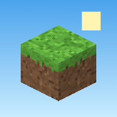

# JippeCraft

Een Minecraft-achtig bouwspel voor Jippe (6 jaar). Het draait in Safari op de iPad
en je hoeft niets te installeren. Het plan staat in [`PLAN.md`](PLAN.md); plannen en prompts
voor de volgende stappen staan in [`docs/`](docs/README.md).

**Speel online:** https://mscheltens83.github.io/Jippe_minecraft/



## Hoe speel je?

| Wat | Hoe |
|---|---|
| **Lopen** | Duim linksonder neerzetten en schuiven (joystick) |
| **Rondkijken** | Met je vinger over het scherm vegen |
| **Bouwen** | Groene knop bovenin aan, dan op een blok tikken. Het nieuwe blok komt tegen dat vlak aan |
| **Toren bouwen** | Recht naar beneden kijken en op de grond onder je tikken: je wipt vanzelf op het nieuwe blok |
| **Slopen** | Rode knop (houweel) bovenin aan, dan je vinger op een blok **vasthouden** tot het rondje vol is. Blijf je vasthouden, dan graaf je verder |
| **Blok kiezen** | Tik op een blok in de onderbalk. De kist rechts heeft zeven tabbladen: Bouwen, Kleuren, Natuur, Licht en huis, Planten, Stempels en Dieren. Een vakje met een hoekje (trap, plaat, hek, deur, bed, …) is een familie: houd het ingedrukt en kies de houtsoort of kleur |
| **Blok kopiëren** | Houd de kistknop ingedrukt en tik met een andere vinger op een blok in de wereld: dat blok komt in je hand (met de muis: middelste muisknop) |
| **Hand** | Rechtsonder zie je je hand met het blok dat je vasthoudt. Hij zwaait als je bouwt of sloopt |
| **Natuur** | Kies junglehout, lianen, bamboe, cactussen, palmen, ijs, savannegras, berkenhout, paddenstoelen, waterlelies, bloemen, klei, graniet, grind en alle ertsen uit de kist. De plaatjes staan per landschap bij elkaar |
| **Stempels** | Kies een huisje, boom, toren, brug, iglo, piramide, tempel, leeuwenrots, dorpshuis of waterput uit de kist en tik op de grond. Het staat er in één keer |
| **Dorpen** | In de Grote wereld ligt altijd een dorp binnen 300 blokken van de start (en verderop meer). Een waterput in het midden, paden, huisjes in de stijl van het landschap (eik, spar, acacia of zandsteen), een bibliotheek, akkers en lantaarnpalen. Dorpelingen (boer, bakker, bibliothecaris) lopen rond en gaan 's nachts naar bed; er wonen katten en een ijzergolem, die je soms een bloem geeft |
| **Ontdekken** | Een schipwrak op het strand of onder water, een oude ruïne in het bos en mijnschachten diep onder de grond, elk met een schatkist |
| **Dieren** | Varkens, kippen, schapen, 24 wilde diersoorten en 15 Minecraft-dieren lopen rond: koe, paard (6 kleuren), hond, kat, konijn, vos, bij, geit, lama, en in het water vis, dolfijn, inktvis, kwal, walvis en kogelvis. Elk landschap in de Grote wereld heeft zijn eigen dieren, en in zee (ook rond het eiland) en rivieren zwemmen veel vissen en andere zeedieren. De dierenkist groepeert hun plaatjes per wereld. Kies een dier en tik op de grond om het neer te zetten (een waterdier in het water); voor een groot dier zoekt het spel zelf een plekje vlak ernaast als het net niet past |
| **Zwemmen op een dolfijn of walvis** | Maak een dolfijn of walvis tam (drie keer aaien; dan krijgt hij een zadeltje) en tik er nog een keer op. Zwem met de stuurknop; de pijl omhoog brengt je naar boven, de pijl omlaag laat je duiken. Bovenaan springt de dolfijn met de pijl omhoog uit het water en plonst terug; de walvis drijft met zijn rug boven water en spuit een fontein. Ze zwemmen niet het land op. Afstappen met de knop rechts |
| **Wilde Nacht** (eng!) | Knop met de maan en rode ogen in het menu. Je komt op een eigen eiland (je eigen werelden blijven heel). Overdag heb je 90 seconden om een huis te bouwen; dan wordt het donker en rennen alle dieren op je af. Raken ze je, dan ben je een hartje kwijt; met 5 hartjes op ben je gepakt. Overleef je de nacht, dan komt de volgende, met meer en snellere dieren en minder tijd. Een dichte deur houdt ze tegen, een open deur niet. Vliegen, stempels en slapen doen niet mee, en van hoog vallen kost een hartje. Het is echt eng: een donkerblauwe nacht met een rode maan, mist, dieren met gloeiende rode ogen, grommen en krabben aan je muur (van links of rechts), een kloppend hart als ze dichtbij zijn, en soms staat er ineens een dier voor je raam. Sommige dieren slopen je muren: varkens en koeien krijgen aarde en glas kapot, de olifant ook hout, de T-rex (vanaf nacht 5) zelfs steen; ijzer en obsidiaan houden alles tegen. Je ziet scheurtjes en kunt een blok op tijd vervangen. Een smalle toren valt om als de onderkant kapot is. Geiten springen over een muur van 2 hoog, apen klimmen eroverheen, en vliegers komen van boven (bouw een dak!). Kippen en vossen durven niet bij een fakkel. De oranje **BOE-knop** jaagt de dieren dichtbij even weg; daarna moet hij 15 seconden opladen. 's Nachts komen de dieren in drie golven, elke golf feller. Je bouwt alleen met je eigen bouwstenen (aantallen in de onderbalk; slopen geeft ze terug), en na elke overleefde nacht verdien je nieuwe: eerst hout en keien, later ijzer en obsidiaan. Naar het menu = stoppen |
| **Dier naar huis sturen** | Er kunnen 60 dieren tegelijk zijn. Zijn het er al zoveel, dan ruimt het spel een wild dier ver weg op als je een nieuw dier neerzet. Gaat dat niet (allemaal je eigen dieren), dan zegt het spel wat je kunt doen: kies de sloopstand en houd je vinger op een dier. Het rondje loopt vol en het dier gaat met een poef naar huis ("Dag schaap!") |
| **Fokken** | Houd lievelingseten vast (tarwezaadjes, wortel of aardappel) en tik op twee dieren van dezelfde soort: ze worden verliefd, zoeken elkaar op en krijgen een jong. Een jong groeit in 10 minuten op; voeren gaat sneller. Roofdieren jagen nooit op een jong dier |
| **Hoe ze bewegen** | De dieren lopen rustig in bochten naar een plekje, trekken op en remmen af, lopen om muren en water heen, deinen en knikken met hun kop, kijken om zich heen en naar jou als je dichtbij staat, en gaan soms even liggen. Kuddedieren blijven bij elkaar, een jong dier loopt achter zijn moeder aan, en vissen zwemmen in scholen |
| **Aaien** | Tik op een dier: hartjes, een eigen geluid en een kunstje. Leeuwen schudden hun manen, de olifant spuit water, het nijlpaard gaapt, de walvis spuit een fontein en de kogelvis blaast zich op |
| **Dierenalbum** | Aai een soort voor het eerst en krijg een sticker. Open het boek in het spel of in het menu om je gevonden dieren te bekijken. Tik op een sticker voor het dierengeluid |
| **Schatkist** | Tik op een schatkist in de tempel of piramide: hij gaat open met gouden glitters en confetti. Terugzetten sluit hem weer |
| **Sneeuwpop** | Stapel twee sneeuwblokken en zet er een pompoen op. De blokken worden een sneeuwpop die rondloopt; terugzetten haalt hem weg |
| **Weer en muziek** | In de toendra valt sneeuw, in de jungle dwarrelen blaadjes. Elk landschap heeft zijn eigen zachte muziek en omgevingsgeluid; 's nachts klinkt een rustig nachtliedje |
| **Wilde dieren** | Jungle: tijger, aap, papegaai, panda, kikker en luiaard. Woestijn: stokstaartje, kameel, woestijnvos, hagedis en schildpad. Toendra: ijsbeer, pinguïn, rendier, poolvos, zeehond en sneeuwuil. Ook de savanne zit vol dieren |
| **Deur** | Tik op een deur om hem open of dicht te doen |
| **Stal** | Bouw een hek met hekdeur om je varkens, kippen en schapen. Tik op de hekdeur om hem open of dicht te doen. Een hooibaal houdt de boerderijdieren in de buurt |
| **Roofdieren** | Leeuwen, leeuwinnen, cheetahs en tijgers jagen soms op boerderijdieren. Je ziet eerst een ! boven de prooi en kunt het roofdier aaien om de jacht te stoppen. In het menu kunnen ouders ‘Roofdieren jagen’ uitzetten |
| **Temmen** | Aai een leeuw, paard, hond, kat, kameel, olifant, cheetah, tijger, dolfijn of walvis drie keer snel achter elkaar. Een zadel of halsband laat zien dat jullie vrienden zijn; hij volgt je. Tik op een tamme hond: hij gaat zitten (nog eens tikken: hij staat weer op) |
| **Rijden** | Tik nog eens op een tam paard, leeuw, kameel, olifant, cheetah of tijger om op te stappen. Een paard en een cheetah zijn snel, een olifant is langzaam. Duw de joystick helemaal naar voren om te rennen, spring over een hek en tik op het leeuw-pijltje om af te stappen |
| **Vuurwerk** | Zet een vuurwerkblok neer en tik erop |
| **Stuiterblok** | Spring erop en je stuitert hoog de lucht in |
| **Springen** | Grote pijl rechtsonder. Tegen een opstapje of trap lopen gaat vanzelf |
| **Vliegen** | Veertje-knop, of twee keer snel op springen tikken. Pijl omhoog en omlaag om te stijgen en te dalen |
| **Sprinten** | Houd de joystick een seconde helemaal naar voren: je rent, de kijkhoek wordt breder en er komen stofwolkjes (op een computer: Ctrl) |
| **Sluipen** | Houd de omlaag-knop ingedrukt terwijl je loopt: je loopt langzaam en valt niet van een rand. Handig bij hoog bouwen |
| **Zwemmen** | Houd springen ingedrukt in water om omhoog te zwemmen, omlaag om te duiken |
| **Poppetje** | Knop rechtsboven: de camera gaat achter je hangen, zodat je jezelf ziet |
| **Oeps!** | De terug-pijl rechtsboven zet de laatste acties terug (ook een hele stempel) |
| **IJs** | Op ijs en pakijs glijd je nog even door als je de joystick loslaat |
| **Modder** | Op modder loop je langzamer |
| **Lianen** | Vooruit tegen een liaan of de springknop klimt omhoog. Laat los om te blijven hangen. De omlaagknop laat je zakken |
| **Menu** | Huisje linksboven: geluid, muziek en de zes wereldplekken |
| **Grote wereld** | De echte Minecraft-wereld: vlaktes, bossen, berkenbossen, bloemenvelden, sparrenbossen, sneeuw, hoge bergen, woestijn, mesa, savanne, jungle, moeras, stranden, zee en slingerende rivieren. Onder de grond liggen grotten met kolen, ijzer, goud, redstone, lapis en diamant |
| **Themawerelden** | Jungle, Woestijn, Toendra en Savanne zijn eindeloos en hebben elk hun eigen landschappen: jungle met bamboebos en moeras; woestijn met mesa; toendra met sparrenbos, bergen en een bevroren zee; savanne met vlaktes. Werelden die je al eerder bewaard had, blijven zoals ze waren |
| **Opdrachtjes en stickers** | In het boek (linksboven) staat naast de dieren het tabblad **Stickers**: 46 opdrachtjes, zoals een bed in een huis zetten, op een paard rijden, een dorp vinden of een dino-ei laten uitkomen. Lukt het, dan vliegt er een sticker in beeld. Tik op een sticker en de iPad leest het opdrachtje voor; **Wat zal ik doen?** kiest er een. Als het geluid uit staat, wordt er niet voorgelezen |
| **Schatkisten en verkleden** | In tempels, piramides, iglo's, schipwrakken, ruïnes, mijnschachten, dorpen, op de leeuwenrots en bij de dinonesten staat een schatkist. Tik erop: je vindt een hoed of een cape (kroon, piratenhoed, cowboyhoed, tovenaarshoed, ridderhelm, bloemenkrans, rode of blauwe cape). Heb je alles, dan zit er goud in. De dino-kap en de regenboogcape krijg je met een sticker. Aantrekken doe je in het boek onder **Verkleden**, waar je ook de kleur van je shirt en broek kiest |
| **Knoppen en hendels** | In de kist onder **Licht en huis**: hendel, knop, drukplaat en schakellamp. Zet er een op de grond bij een deur, een hek of een schakellamp (hoogstens 4 blokken ver). Tik op de hendel: de deur gaat open en de lamp aan; nog een keer tikken doet ze weer dicht en uit. Een knop is twee tellen aan. Een drukplaat is aan zolang jij of een dier erop staat. Er zijn geen draden nodig |
| **Rails, karretje en bootje** | In de kist onder **Rijden**. Leg rails neer: ze sluiten vanzelf aan, ook in een bocht of schuin omhoog. Zet het karretje op de rails, tik erop en rijd met de stuurknop (vooruit = doorrijden, achteruit = remmen). Het bootje zet je op het water; tik erop en vaar. Uitstappen met de knop rechts, zoals bij een dier |
| **Dinowereld** | Een eindeloze wereld met een varenvlakte, een oerbos met boomvarens en apenbomen, en vulkanen (rook en gloeiende magmasteen, maar geen lava). Zeven vriendelijke dino's: T-rex, Brachiosaurus en Triceratops kun je temmen (drie keer aaien) en berijden, de Velociraptor volgt je als hij tam is, de Pteranodon vliegt. Tik op een **dino-ei** en er komt een jonge dino uit. Onder de grond liggen fossielen en barnsteen. Je komt er met **rode portaalsteen**, of kies hem als nieuwe wereld |
| **Portalen** | In de kist onder **Portalen**: portaalsteen in 4 kleuren en de toverstaf. Bouw een frame van portaalsteen (4 breed en 5 hoog, of groter), tik erop met de toverstaf en het portaal gaat aan. Groen gaat naar de Jungle, geel naar de Woestijn, wit naar de Toendra, oranje naar de Savanne en rood naar de Dinowereld. Loop erdoorheen: daar staat een portaal terug. Je dier (waar je op rijdt, of een tam dier dat je volgt) gaat mee. Te moeilijk? De portaal-stempel zet er in één tik een neer |
| **Eindeloze wereld** | De wereld houdt nergens op: loop, zwem of vlieg zo ver je wilt. Verderop liggen nieuwe stukken land, bomen, dieren en soms een tempel, piramide, iglo of leeuwenrots |
| **Dag en nacht** | Een hele dag duurt 20 minuten. 's Avonds kleurt de lucht oranje, 's nachts zie je de maan en sterren, gaan de dieren slapen en hoor je krekels en een uil |
| **Licht** | In de kist onder **Licht**: fakkel (op de grond of tegen een muur), lantaarn (staand, of hangend als je onder een blok tikt), gloeisteen, pompoenlantaarn en kampvuur. Ze geven een cirkel van licht, ook in donkere grotten. De lamp en het regenboogblok geven nu ook echt licht |
| **Bed** | Tien kleuren bedden in de kist onder **Licht**. Tik op een bed: dat is nu je thuis (de huisknop brengt je erheen). Is het nacht, dan slaap je en is het meteen weer ochtend |
| **Mooie wereld** | Texturen in Minecraft-stijl, gras en bladeren in de kleur van het landschap (felgroen in de jungle, geelgroen op de savanne), golvend water, blokwolken en brokjes van het echte blok als je sloopt |
| **Onder water** | Alles wordt blauw en klinkt gedempt |
| **Geluid** | Voetstappen op gras, steen, hout, zand en sneeuw; vogels overdag, druppels in grotten en golven bij de zee |
| **Bouwen** | Vijf houtsoorten (eik, berk, spar, jungle, acacia) met planken, trappen, platen, hekken, hekdeuren en deuren; stenen bakstenen, kwarts, obsidiaan en meer. Een stam ligt als je op een zijkant tikt; twee platen op elkaar worden één blok; tik je op de bovenhelft van een zijkant, dan komt een trap ondersteboven |
| **Kleuren** | 16 kleuren wol, tapijt, beton, terracotta, glas en glazen panelen (panelen groeien aan elkaar vast) |
| **In huis** | Werkbank, oven (tik: hij gaat aan en geeft licht), kist (gaat open en dicht), ladder (klimmen), bloempot, jukebox (speelt een liedje) en taart (tik: een hapje) |
| **Water en zand** | Water stroomt vanuit een bron 7 blokken ver en valt naar beneden. Met de emmer zet je een bron neer of haal je hem weg. Zand en grind vallen als er niets onder zit; bloemetjes zonder grond vallen om |
| **Moestuin** | Tarwezaadjes, wortels en aardappels op gras of aarde: de grond wordt een akker en in ±5 minuten groeit alles. Gras groeit langzaam over kale aarde |
| **Naar huis** | Kompasje linksboven: met een wolkje glitters sta je weer op je bouwplek (rijd je op een dier, dan gaat het mee). Ben je ver weg, dan wijst een geel pijltje boven de onderbalk de weg naar huis |

In het menu onder **Werelden** staan zes plekken in twee rijen, elk met een plaatje van je wereld.
Tik op een wereld om erheen te gaan, op een lege plek (+) om een nieuwe te maken,
of op het rondje-pijltje om een wereld opnieuw te beginnen (dat vraagt eerst of je het zeker weet).
Je kiest uit **Grote wereld, Eiland, Plat, Jungle, Woestijn, Toendra en Savanne**. Alle werelden zijn
eindeloos. In de Grote wereld begin je altijd in een vlakte met bos in de buurt; muziek, lucht en
weer veranderen mee met het landschap waar je bent. Oude avonturenwerelden blijven speelbaar. Het Eiland is één groot eiland van ongeveer 400 blokken in een zee zonder einde.
In Avontuur liggen de vier landschappen rondom een centrale weide en lopen ze verderop door.
Werelden van vóór versie 4 zijn netjes overgezet: het oude stuk van 96 × 96 blokken ligt nu
in een zee, en daarachter begint nieuwe wereld om te ontdekken.
Zoek een tempel, piramide, iglo, leeuwenrots, drinkplaats of oase. De bouwplek in het
midden blijft vlak. Tik op een schatkist voor confetti en gouden glitters.
Een leeuw luiert op de leeuwenrots, cheetahs sprinten met stofwolkjes en tijgers zwemmen.
Giraffen eten bij acacia's, zebra's zoeken elkaar op en stokstaartjes duiken weg als je ze aait.
Papegaaien en sneeuwuilen vliegen, apen en luiaards klimmen, pinguïns glijden over ijs
en panda's zoeken bamboe. Tik op een dier om zijn eigen geluid en kunstje te zien.
Nieuwe dieren verschijnen vanzelf in een **nieuwe** wereld. Bewaarde werelden behouden
hun dieren; daar kun je de nieuwe soorten zelf uit de kist neerzetten.
Het dierenalbum telt ontdekkingen uit alle werelden samen. De stickers blijven bewaard;
"Album leegmaken" vraagt eerst om bevestiging.

Op een computer werkt het ook: **WASD** of pijltjes lopen, **slepen** met de muis kijkt rond,
**klikken** bouwt (in de sloop-stand: muisknop vasthouden), **rechtermuisknop** doet het omgekeerde,
**spatie** springt (twee keer snel: vliegen), **Shift** daalt of sluipt, **Ctrl** sprint, **middelste muisknop** kopieert een blok, **F** vliegen, **C** poppetje, **M** muziek, **E** kist,
**Q** wisselen tussen bouwen en slopen, **1–9** blok kiezen, **Ctrl+Z** terug, **Esc** menu.

### Veilig voor kinderen
- Geen monsters of schade aan de speler; de speler heeft geen honger. Het wordt 's nachts nooit pikdonker, en ouders kunnen "altijd dag" aanzetten. Een gevangen boerderijdier verdwijnt in een vriendelijke poef en kan meteen opnieuw uit de kist worden geplaatst.
- Je kunt niet uit de wereld vallen (onbreekbare bodem). Op 4.096 blokken van huis is een rand, en de huisknop brengt je altijd terug.
- Slopen moet je even vasthouden, dus je sloopt niet per ongeluk je huis.
- De werelden worden vanzelf bewaard (in de browser, in IndexedDB; alleen de stukken waar je iets veranderde). Een wereld weggooien vraagt altijd eerst om bevestiging. Op het ouderscherm kun je een reservekopie maken.
- Geen reclame, geen internet nodig tijdens het spelen, geen gegevens die ergens heen gaan.

### Op een oudere iPad
Het spel begint op een tablet iets minder scherp en past zich aan: haalt de iPad het niet,
dan tekent hij nog wat minder scherp; is de iPad snel, dan juist scherper.

### Voor ouders: versie, meetscherm en meetrit
Onderin het menu staat klein het **versienummer**. Zo zie je of de iPad de nieuwste versie heeft.
**Houd het versienummer 3 seconden vast** voor het ouderscherm. Daar staan:
- het apparaat, de beeldscherpte, hoeveel werelden er bewaard zijn en hoeveel opslag dat kost;
- de **laatste fouten** (als er iets misging), met een knop om alles te kopiëren;
- **Meetscherm aan/uit**: een klein kader rechtsboven met beelden per seconde (fps), de traagste
  beeldjes (p95) en hoeveel de iPad moet tekenen. Op een computer kan het ook met `?fps` achter het adres;
- **Dag en nacht**: aan, of **altijd dag** (dan blijft het middag);
- **Grotten lichter**: grotten en de nacht worden iets minder donker;
- **Reservekopie maken**: alle werelden in één bestand (op de iPad via het deelmenu, bijvoorbeeld
  naar Bestanden). Met **Reservekopie terugzetten** zet je zo'n bestand weer terug;
- **Meetrit**: de camera vliegt 30 seconden over een savanne met 60 dieren en laat daarna zien
  hoe vlot het spel liep. Maak er een schermafbeelding van. De werelden van Jippe blijven precies
  zoals ze waren. Op een computer: `?meet` achter het adres (`?meet=10` voor 10 seconden).
- **Texturen bekijken**: zet `?texturen` achter het adres voor een pagina met alle tegels groot op een rij.

## Op de iPad zetten

Het spel bestaat uit gewone webbestanden. Het moet op een website staan (via `https://`).

### Als echte app op het beginscherm
Het spel staat online op https://mscheltens83.github.io/Jippe_minecraft/ en werkt vanaf iPadOS 15.
De oude claude.ai-links laten een oude versie zien; gebruik die niet meer.
Zelf ergens anders neerzetten kan ook:
1. Zet de bestanden op een gratis webhost, bijvoorbeeld:
   - **GitHub Pages**: kan bij een privé-repository alleen met een betaald GitHub-abonnement.
     Anders de repository openbaar maken. Daarna: *Settings → Pages → Deploy from a branch →*
     kies de branch met het spel en map `/ (root)`. Na een minuutje staat het op
     `https://mscheltens83.github.io/Jippe_minecraft/`.
   - **Netlify Drop** (<https://app.netlify.com/drop>): sleep de hele map erin.
   - **Cloudflare Pages**: koppel de repository.
2. Open de website op de iPad in **Safari**.
3. Tik op **Deel** (vierkantje met pijl) → **Zet op beginscherm**.
4. Nu staat er een JippeCraft-icoon. Het opent schermvullend en werkt ook zonder internet.

> Tip voor ouders: met **Begeleide toegang** (Instellingen → Toegankelijkheid) kun je de
> iPad vastzetten in het spel.

## Zelf aanpassen / testen

Geen bouwstap nodig: het zijn gewone HTML-, CSS- en JavaScript-bestanden.

```bash
npm start          # start een lokale webserver op http://localhost:8080
npm install        # eenmalig, voor de test
npm run lint       # zoekt tikfouten en vergeten variabelen in de code
npm test           # unit-tests (snel, zonder browser) en daarna het spel in een gesimuleerde iPad
FASE=basis,c,4b npm run test:browser   # alleen een paar onderdelen van de browsertest
npm run icons      # maakt de app-iconen opnieuw
```

Bij elke pull request en elke push naar de speelbranch draait GitHub dezelfde controles
(`.github/workflows/test.yml`). De schermafbeeldingen van de test staan daar bij de uitslag.

### Bestanden
| Bestand | Wat doet het? |
|---|---|
| `index.html` | De startpagina |
| `artifact.html` | Dezelfde pagina, maar dan voor een claude.ai-artifact |
| `css/style.css` | De opmaak van knoppen en menu's |
| `js/main.js` | Opstarten, de spel-lus, bouwen en slopen |
| `js/blocks.js` | Alle bloktypes (hier kun je blokken toevoegen) |
| `js/textures.js` | De pixel-art texturen, getekend met code |
| `js/world.js` | Doorgeefluik naar `js/engine/world.js` (de oude imports blijven werken) |
| `js/engine/` | De eindeloze wereld: `world.js` (chunks), `gen.js` (landschap per chunk), `climate.js` (biomen, bergen en rivieren van de Grote wereld), `caves.js` (grotten en ertsen), `noise.js` (ruis), `trees.js` (boomvormen), `mesher.js` (3D-vlakken per sectie, met licht), `light.js` (zonlicht en lamplicht per blok), `tint.js` (kleur van gras, blad en water per landschap), `physics.js` (vallend zand, stromend water, groeiende gewassen), `worker.js` + `pool.js` (werk in de achtergrond), `loader.js` (laden en opruimen rond de speler), `save.js` (IndexedDB en reservekopie), `migrate.js` (oude werelden omzetten) |
| `js/biomes.js` | Landschap, bomen, planten, lucht en mist per wereld |
| `js/structures.js` | Tempels, piramides, iglo's, leeuwenrotsen, drinkplaatsen en oases |
| `js/scene.js` | Lucht, zon, maan, sterren, wolken, de zee rondom en de licht-shader |
| `js/daynight.js` | De tijd van de dag (20 minuten per dag) |
| `js/texview.js` | De testpagina `?texturen` |
| `js/player.js` | Lopen, sprinten, sluipen, springen, vliegen, zwemmen en botsen |
| `js/hand.js` | De hand met het blok rechtsonder in beeld |
| `js/raycast.js` | Welk blok tik je aan? |
| `js/input.js` | Touch, muis en toetsenbord |
| `js/ui.js`, `js/icons.js` | Knoppen, onderbalk, kist en menu |
| `js/audio.js` | Zelfgemaakte geluidjes (ook dierengeluidjes en vuurwerk) |
| `js/music.js` | Rustige muziek per landschap, met code gemaakt |
| `js/weather.js` | Sneeuw, dwarrelende blaadjes en zacht omgevingsgeluid |
| `js/album.js` | Ontdekte dieren en stickers uit hun 3D-figuren |
| `js/snowman.js` | De lopende sneeuwpop bewaren en bewegen |
| `js/animals.js` | Dieren per wereld neerzetten, aantikken, bewaren en laden (maximaal 60) |
| `js/animals/` | Recepten, gedeelde 3D-figuren, beweging, slapen, zwemmen, sprinten en kunstjes |
| `js/avatar.js`, `js/models.js` | Het poppetje en de blokkige figuurtjes |
| `js/stamps.js` | De stempels: huisje, boom, toren en brug |
| `js/animals/dinos.js` | De zeven dino's van de Dinowereld |
| `js/switches.js` | Knoppen, hendels en drukplaten: welke deuren, hekken en lampen meegaan |
| `js/rails.js`, `js/animals/vehicles.js` | Rails die vanzelf aansluiten, het karretje dat de rails volgt, en het bootje |
| `js/wardrobe.js` | Verkleden: hoeden, capes, kleuren en wat er in een schatkist zit |
| `js/quests.js`, `js/speech.js` | De opdrachtjes met stickers, en het voorlezen |
| `js/storm.js` | De Wilde Nacht: de klok, de hartjes, de jagende dieren en of je huis dicht is |
| `js/portal.js` | Portalen: een frame van portaalsteen herkennen, een kant-en-klaar portaal bouwen, zien of je in een portaal staat |
| `js/particles.js` | Brokjes, vuurwerk, hartjes, glitters, Zzz, stof, waterdruppels en rook |
| `js/version.js` | Het versienummer (hoort bij `CACHE` in `sw.js`) |
| `js/errors.js` | Foutenlogboek: de laatste 20 fouten |
| `js/perf.js`, `js/bench.js` | Meetscherm (`?fps`) en meetrit (`?meet`) |
| `js/parent.js` | Het ouderscherm |
| `js/storage.js` | Instellingen en de oude werelden van vóór versie 4 (localStorage) |
| `sw.js`, `manifest.webmanifest` | Offline spelen en "zet op beginscherm" |
| `tests/` | Browsertests per fase (`smoke.mjs`, `phase-*.mjs`) en unit-tests (`unit/`) |
| `lib/three.module.min.js` | [Three.js](https://threejs.org) r170 (MIT-licentie), voor de 3D-weergave |

### Een blok toevoegen
1. Teken een textuur in `js/textures.js` (een functie in `GEN`, 16×16 pixels).
2. Voeg het blok toe in `js/blocks.js` met `def(...)` en zet het in `PALETTE_GROUPS`.

### Een stempel toevoegen
Schrijf in `js/stamps.js` een nieuw stuk bij `buildStamp` (met `put(links, omhoog, vooruit, blok)`),
voeg in `js/blocks.js` een regel toe aan `ITEM` en `SPECIALS`, en geef het een plaatje in `js/icons.js`.
